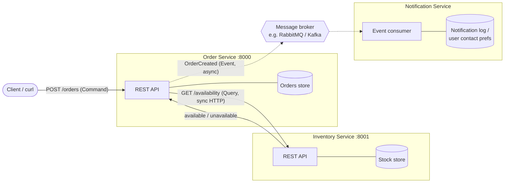

# CMPE 273 – Module 4: Architecture & Service Boundaries

A small online store split into independent services. The **Order Service** and
**Inventory Service** are implemented in Python (Flask) and run as separate
processes that talk over HTTP. The **Notification Service** is part of the
design and is shown as an event consumer; the Order Service emits the
`OrderCreated` event (currently logged) where it would be published to a broker.

## Repository layout

```
.
├── inventory_service/app.py   # Inventory Service (port 8001)
├── order_service/app.py       # Order Service (port 8000)
├── demo.sh                    # Runs success, rejection, and failure scenarios
├── demo_output.txt            # Captured output of ./demo.sh
└── requirements.txt
```

## Installing and running

Requires Python 3.9+.

```bash
git clone https://github.com/shruthikatta/cmpe273-module4-assignment.git
cd cmpe273-module4-assignment
python3 -m venv .venv
source .venv/bin/activate
pip install -r requirements.txt
```

Start each service in its **own terminal** (they are independent processes):

```bash
# Terminal 1 – Inventory Service on http://127.0.0.1:8001
python inventory_service/app.py

# Terminal 2 – Order Service on http://127.0.0.1:8000
python order_service/app.py
```

Submit an order from a third terminal:

```bash
curl -X POST http://127.0.0.1:8000/orders \
  -H 'Content-Type: application/json' \
  -d '{"item_id": "apple", "quantity": 2}'
```

Or run every scenario (including the failure test) automatically:

```bash
./demo.sh
```

> Port 8000 is used instead of 5000 because macOS reserves port 5000 for the
> AirPlay Receiver. Ports can be changed with `ORDER_PORT`, `INVENTORY_PORT`, and
> `INVENTORY_URL` environment variables.

### API

| Service   | Method & path                                   | Purpose                        |
|-----------|-------------------------------------------------|--------------------------------|
| Order     | `POST /orders` body `{"item_id", "quantity"}`   | Create an order                |
| Order     | `GET /orders`, `GET /orders/<id>`               | Track orders                   |
| Inventory | `GET /inventory/<item_id>/availability?quantity=N` | Check availability          |
| Inventory | `GET /inventory`                                | List sample stock              |
| Both      | `GET /health`                                   | Liveness check                 |

Sample inventory: `apple` (10), `banana` (0), `laptop` (3), `headphones` (25).

## 1. Architecture



Solid arrows are synchronous request/response calls (implemented). Dotted
arrows are asynchronous events (designed; the Order Service logs the event at the
point where it would publish to the broker).

### Component responsibilities and data ownership

| Component                | Responsibility                                                                                                   | Data it owns                                                  |
|--------------------------|------------------------------------------------------------------------------------------------------------------|---------------------------------------------------------------|
| **Order Service**        | Accepts order requests, validates input, asks Inventory whether the item is available, creates and tracks orders, and announces that an order was created. | Orders: order ID, item ID, quantity, status, timestamps.      |
| **Inventory Service**    | Single source of truth for stock. Answers availability queries (and, in a fuller system, reserves/decrements stock). | Items and stock levels (item ID, name, quantity on hand).     |
| **Notification Service** | Listens for `OrderCreated` events and notifies the user (email/SMS/push). Never blocks order creation.            | Notification history, delivery status, user contact preferences/templates. |

Each service has its **own private data store**. No service reads another
service's data directly; it must go through that service's API or react to its
events.

### Why these service boundaries

- **Each boundary follows a distinct business capability.** Ordering, stock
  management, and user communication change for different reasons and are
  owned by different concerns, so they can evolve and deploy independently.
- **One owner per piece of data.** Inventory is the only writer of stock counts,
  so there is no risk of two services disagreeing about how many items exist.
  Orders likewise live only in the Order Service.
- **Coupling matches the need.** Order creation *must* know availability before
  it succeeds, so that call is synchronous. Notifying the user does not need to
  finish before the order is confirmed, so it is an asynchronous event; if the
  Notification Service is down, orders still work.
- **Independent scaling and failure isolation.** Inventory reads may be far more
  frequent than order writes; notifications may spike. Separate processes let
  each scale on its own and let failures be contained (see the failure test).

## 2. Command, Query, and Event

| Interaction                           | Type        | Why |
|---------------------------------------|-------------|-----|
| Check whether an item is available    | **Query**   | It asks for information and returns data without changing any state. Calling it repeatedly has no side effects (`GET /inventory/<id>/availability`). |
| Create an order                       | **Command** | It is a request to *do* something that changes state (a new order is stored). It is directed at one specific service and can be accepted or rejected (`POST /orders`). |
| Order was created                     | **Event**   | It is a notification, in the past tense, that something already happened. The Order Service broadcasts it without knowing or waiting for who consumes it (e.g. Notification Service). |

## 3. Implementation: Order Service → Inventory Service

When `POST /orders` is received, the Order Service:

1. Validates `item_id` and `quantity`.
2. Calls `GET http://127.0.0.1:8001/inventory/<item_id>/availability?quantity=N`
   with a 2-second timeout.
3. If Inventory returns `available`, stores the order and returns **201 Created**,
   then emits the `OrderCreated` event.
4. If Inventory returns `unavailable`, returns **409 Conflict** and no order is created.
5. If Inventory cannot be reached (connection refused, timeout, or 5xx), returns
   **503 Service Unavailable** and keeps serving other requests.

### Example: successful request

```
$ curl -X POST http://127.0.0.1:8000/orders -H 'Content-Type: application/json' -d '{"item_id": "apple", "quantity": 2}'
{"order":{"created_at":"2026-10-20T22:04:38.617707+00:00","item_id":"apple","order_id":1,"quantity":2,"status":"created"},"order_status":"created"}

HTTP status: 201
```

The Inventory Service's own answer for the same item:

```
$ curl http://127.0.0.1:8001/inventory/apple/availability?quantity=2
{"in_stock":10,"item_id":"apple","requested_quantity":2,"status":"available"}
```

### Example: item unavailable

```
$ curl -X POST http://127.0.0.1:8000/orders -H 'Content-Type: application/json' -d '{"item_id": "banana", "quantity": 1}'
{"inventory":{"in_stock":0,"item_id":"banana","requested_quantity":1,"status":"unavailable"},"order_status":"rejected","reason":"Item 'banana' is unavailable"}

HTTP status: 409
```

## 4. Failure test: Inventory Service stopped

The Inventory Service process was killed, then another order was submitted.

```
=== 3. Failure test: stopping Inventory Service (PID 59281) ===
$ curl -X POST http://127.0.0.1:8000/orders -H 'Content-Type: application/json' -d '{"item_id": "laptop", "quantity": 1}'
{"error":"Inventory Service is unavailable. Please try again later.","order_status":"not_created"}

HTTP status: 503

=== 4. Order Service is still running after the failure ===
$ curl http://127.0.0.1:8000/health
{"service":"order","status":"ok"}

HTTP status: 200

$ curl http://127.0.0.1:8000/orders
[{"created_at":"2026-10-20T22:04:38.617707+00:00","item_id":"apple","order_id":1,"quantity":2,"status":"created"}]
```

Order Service log during the test:

```
[2026-10-20 15:04:38,618] INFO EVENT OrderCreated: {'order_id': 1, 'item_id': 'apple', 'quantity': 2, 'status': 'created', 'created_at': '2026-10-20T22:04:38.617707+00:00'}
[2026-10-20 15:04:38,618] INFO 127.0.0.1 - - [20/Oct/2026 15:04:38] "POST /orders HTTP/1.1" 201 -
[2026-10-20 15:04:38,630] INFO 127.0.0.1 - - [20/Oct/2026 15:04:38] "POST /orders HTTP/1.1" 409 -
[2026-10-20 15:04:39,662] ERROR Inventory Service call failed: HTTPConnectionPool(host='127.0.0.1', port=8001): Max retries exceeded with url: /inventory/laptop/availability?quantity=1 (Caused by NewConnectionError("HTTPConnection(host='127.0.0.1', port=8001): Failed to establish a new connection: [Errno 61] Connection refused"))
[2026-10-20 15:04:39,662] INFO 127.0.0.1 - - [20/Oct/2026 15:04:39] "POST /orders HTTP/1.1" 503 -
[2026-10-20 15:04:39,678] INFO 127.0.0.1 - - [20/Oct/2026 15:04:39] "GET /health HTTP/1.1" 200 -
[2026-10-20 15:04:39,690] INFO 127.0.0.1 - - [20/Oct/2026 15:04:39] "GET /orders HTTP/1.1" 200 -
```

**Result:** the Order Service caught the connection error, returned
`503 Service Unavailable` with a clear message, did not create a partial order,
and kept running — `/health` and `/orders` still respond with `200`. The full
run is in [`demo_output.txt`](demo_output.txt).

To reproduce manually: start both services, press `Ctrl+C` in the Inventory
terminal, then re-run the `curl -X POST .../orders` command.

## Reflection

Clear service boundaries and data ownership are important because they let each
service be built, deployed, scaled, and debugged independently without hidden
dependencies on another team's internals. When exactly one service owns a piece
of data, such as Inventory owning stock counts, there is a single source of truth
and no risk of two services writing conflicting values into a shared database.
Well-defined boundaries also make the communication between services explicit,
which forces us to choose deliberately between synchronous queries/commands and
asynchronous events. That explicitness is what makes failure handling possible:
in this project, the Order Service knows exactly which dependency failed and can
return a 503 instead of crashing, while the asynchronous notification path means
a Notification outage would never block order creation.
